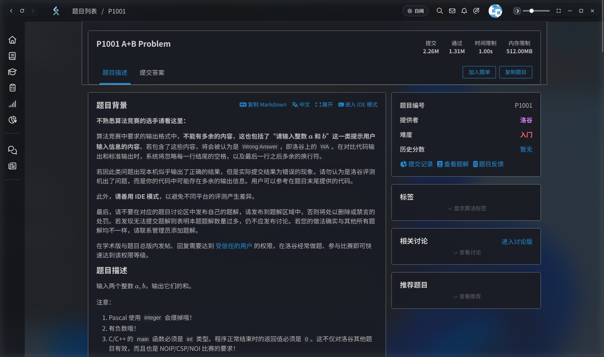
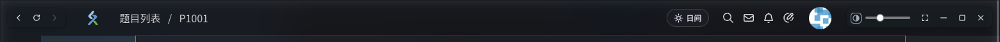
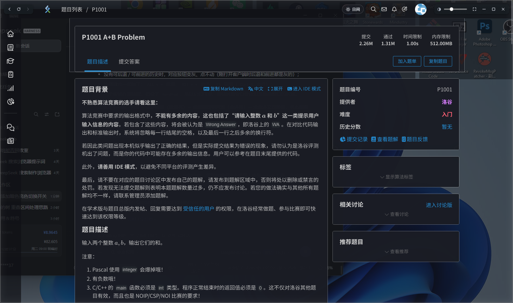

# 洛谷桌面客户端（非官方）

把洛谷装进一个干净的小窗口：没有地址栏、标签页、书签栏；深色 / 浅色一键切换；窗口还能透出桌面，想看清就看清、想磨砂就磨砂。

> 这是个人做的第三方外壳，**和洛谷官方没有任何关系**，不包含、不分发洛谷的任何代码或素材。

**当前版本 v1.0.3** ｜ [更新日志](CHANGELOG.md) ｜ [下载](https://github.com/kaiyuan-123/luogu-client/releases)



---

## 目录

- [这是什么](#这是什么)
- [下载就能用（推荐，小白看这里）](#下载就能用推荐小白看这里)
- [第一次打开要知道的三件事](#第一次打开要知道的三件事)
- [界面导览](#界面导览)
- [两种透明效果](#两种透明效果)
- [快捷键](#快捷键)
- [常见问题](#常见问题)
- [从源码安装](#从源码安装)
- [卸载](#卸载)
- [目录结构](#目录结构)
- [原理（技术细节，可选读）](#原理技术细节可选读)
- [免责声明](#免责声明)
- [许可](#许可)

---

## 这是什么

就是一个**专门用来刷洛谷的窗口**，里面跑的还是洛谷官网（`www.luogu.com.cn`），只是把浏览器那层外壳去掉了：

- 没有地址栏、标签页、书签栏，一个窗口只有洛谷；
- 深色 / 浅色一键切换，配色是照着洛谷页面结构重做的，图片不会变成负片；
- 窗口背景半透明，能透出桌面；可以在「纯透明」和「磨砂」之间切，右边还有滑块调透明度；
- 全屏、后退 / 前进 / 刷新、快捷键，该有的都有；
- 登录态、缓存只存在你自己的电脑上，不上传任何东西。

**适合谁**：天天刷洛谷、又嫌网页版太亮或者太乱的人。
**不适合谁**：想拿它批量爬题、自动提交的人——它没有这些功能，也不打算有。

---

## 下载就能用（推荐，小白看这里）

**不需要装 Python、Node.js，不需要会命令行。**

### 第 1 步：下载压缩包

打开仓库右侧的 **Releases**（或直接访问 `https://github.com/kaiyuan-123/luogu-client/releases`），找到最新版本，在下面 **Assets** 里点 `luogu-client-win64.zip` 下载。

> 文件大约 150MB，里面已经带了运行环境，不用再装别的东西。

### 第 2 步：解压

把下载到的 zip **右键 → 全部解压缩**，解压到一个你找得到的地方，比如：

```
D:\LuoguClient
```

> ⚠️ 不要直接在压缩包里双击运行，一定要先解压出来。

### 第 3 步：双击启动

打开解压出来的文件夹，双击 **`启动洛谷.vbs`**。

等几秒，洛谷的窗口就出来了。第一次打开会慢一点（要初始化缓存），之后就快了。

### 第 4 步（可选）：放到桌面

想以后一点就开：

1. 右键 `启动洛谷.vbs`
2. **发送到 → 桌面快捷方式**
3. 桌面会多一个快捷方式，可以重命名成「洛谷」；想换图标就右键 → 属性 → 更改图标，选文件夹里的 `app\icon.ico`

### 如果 Windows 拦截了

第一次运行可能出现下面两种提示，都不是病毒（因为这是没有数字签名的个人程序）：

- **「Windows 已保护你的电脑」**：点 **更多信息** → **仍要运行**；
- **杀毒软件报毒**：Electron 程序被误报很常见，把这个文件夹加入信任 / 白名单即可。

---

## 第一次打开要知道的三件事

**1. 登录**

窗口右上角点「登录」，正常用洛谷账号登录即可。登录一次之后会一直记住。

**2. 数据存在哪**

第一次启动后，文件夹里会多出一个 **`数据`** 文件夹：

```
你的文件夹\
├─ app\              ← 程序（可以改配置）
├─ electron\         ← 运行环境（删了就打不开）
├─ 数据\             ← 登录状态、缓存、窗口位置都在这
├─ 启动洛谷.vbs      ← 双击这个启动
└─ 说明.txt
```

- 想**退出登录 / 清空缓存**：关掉窗口，删掉 `数据` 文件夹，重新打开即可；
- 想**搬走整个客户端**：把整个文件夹复制走就行，双击 vbs 照常用（登录状态跟着走）。

**3. 怎么关掉去广告**

打开 `app\config.json`，用记事本改：

```json
{
  "hidePromos": true,
  "blockAds": true
}
```

- `hidePromos`：隐藏站内推广位（右侧「洛谷推荐」那一类）
- `blockAds`：拦截常见广告 / 统计域名

改成 `false` 保存，重启客户端生效。改坏了也不要紧，删掉这个文件会自动用默认值。

---

## 界面导览



| 位置 | 是什么 | 说明 |
| --- | --- | --- |
| 最左边 `‹ ↻ ›` | 后退 / 刷新 / 前进 | 没有历史时对应按钮会变灰 |
| 左二 | 洛谷 logo + 面包屑 | 点 logo 回首页 |
| 右侧 `☾ 夜间` / `☀ 日间` | 深色 / 浅色切换 | 会记住你的选择 |
| 右侧半圆图标 | 透明效果菜单 | 点开选「纯透明 / 磨砂」 |
| 右侧滑块 | 背景透明度 | 往左更实、往右更透 |
| 右侧 `⛶` | 全屏 | 全屏时这一排按钮会隐藏 |
| 右侧 `—` `□` `✕` | 最小化 / 最大化 / 关闭 | 最大化后再点一次是还原 |
| 右侧 `↗` | 用浏览器小窗打开当前页 | 提交答案用（验证码只在真浏览器里能过） |

窗口本身没有标题栏，所以：

- **移动窗口**：按住顶栏空白处拖；
- **调整大小**：拖窗口的四条边或四个角。

---

## 两种透明效果

| 纯透明 | 磨砂 |
| --- | --- |
|  |  |
| 桌面原样透出来，壁纸细节都看得见 | Windows 把窗口背后的桌面模糊掉，只透颜色 |

**怎么切**：点顶栏右侧那个半圆图标 → 菜单里选「纯透明」或「磨砂」，当前生效的那项后面有 ✓。

> 磨砂用的是 Windows 11 的亚克力（acrylic）材质，Windows 10 没有这个效果，会自动退化成纯透明。

**透明度**：滑块越靠右越透。深色 + 磨砂把滑块拉满时会保留一层很淡的暗色底，避免整页被磨砂冲成灰白。

---

## 快捷键

| 快捷键 | 作用 |
| --- | --- |
| `Alt + ←` | 后退 |
| `Alt + →` | 前进 |
| `F5` / `Ctrl + R` | 刷新 |
| `F11` | 进入 / 退出全屏 |
| `Esc` | 退出全屏 |
| `Alt + Shift + D` | 深色 / 浅色切换 |
| `Ctrl + M` | 最小化 |
| `Ctrl + W` | 关闭窗口 |
| `Ctrl + +` / `Ctrl + -` / `Ctrl + 0` | 放大 / 缩小 / 还原 |

---

## 常见问题

**双击 `启动洛谷.vbs` 没反应？**

- 检查文件夹里有没有 `electron\electron.exe`——没有就是解压不完整，重新解压一次；
- 右键 vbs → 编辑，看看里面写的路径对不对（正常是相对路径，能跟着文件夹走）；
- 也可能是杀毒软件把 `electron.exe` 隔离了，去隔离区恢复并加白名单。

**窗口是白的 / 一直转圈 / 提示连不上？**

客户端内置了一个「连不上洛谷」的错误页，点「重试」即可。如果一直不行，先在浏览器里打开 `www.luogu.com.cn` 确认网络正常，或者检查代理软件。

**磨砂没效果？**

需要 Windows 11。Windows 10 上系统不提供这个材质，菜单里选了也不会变，属正常现象。

**字看起来有点糊 / 太透看不清？**

- 把透明度滑块往左拉（更实）；
- 或者在纯透明 / 磨砂之间换一个试试；
- 也别把窗口拉得特别小——页面是自适应布局，太小会挤。

**窗口拖不动 / 拉不大？**

拖顶栏空白处是移动；拉边角是调整大小（四边和四角都有热区，鼠标移上去会变成双箭头）。全屏和最大化状态下不能再拉伸，先还原。

**关闭窗口后进程还在？**

正常关闭就是退出程序。如果任务管理器里还有残留的 `electron.exe`，右键结束任务即可（一般是上次异常退出留下的）。

**提交答案时报 `300 unpass error - Failed to verify captcha`？**

洛谷的人机验证（网易易盾）会把 Electron 判成"非浏览器环境"，点得再准也会被判 `result:false`。
所以从 **v1.0.2** 起，提交动作会**转交系统浏览器**：点「提交评测」/ IDE 里的「提交」时，
代码自动复制到剪贴板，并用 Chrome / Edge 的 `--app` 小窗打开本题——在小窗里 `Ctrl+V`、
提交、过验证码即可。也可以随时右键 → 「在浏览器里提交（可过验证码）」。

**更新了新版本，登录会丢吗？**

不会——登录状态在 `数据` 文件夹里。解压新版本时**不要覆盖 `数据` 文件夹**，或者把旧的 `数据` 拷到新文件夹里就行。

---

## 从源码安装

会一点命令行的话，可以自己拉源码装：

```powershell
git clone https://github.com/kaiyuan-123/luogu-client.git
cd luogu-client
powershell -ExecutionPolicy Bypass -File .\tools\install.ps1
```

脚本会：

1. 把 `app\` 复制到 `D:\LuoguClient`（没有 D 盘就用 `%LOCALAPPDATA%\LuoguClient`）；
2. 下载 Electron 运行时（约 150MB）；
3. 生成 `启动洛谷.vbs`；
4. 在桌面创建「洛谷」快捷方式。

换安装位置：

```powershell
powershell -ExecutionPolicy Bypass -File .\tools\install.ps1 -Target "E:\Apps\LuoguClient"
```

只改了 `app\theme.css` 想立刻看效果？关掉窗口重新打开就行，不用重新安装。

---

## 卸载

1. 关掉客户端；
2. 删掉整个文件夹（比如 `D:\LuoguClient`）；
3. 删掉桌面快捷方式。

不写注册表、不装服务、不开机自启，删干净就没了。

---

## 目录结构

```
luogu-client/
├─ app/                 程序本体
│  ├─ main.js           主进程：窗口、IPC、快捷键、请求拦截
│  ├─ preload.js        页面注入：主题开关、透明度、导航按钮、去广告
│  ├─ theme.css         深色 / 浅色 / 透明 的全部样式
│  ├─ offline.html      断网时的错误页
│  ├─ config.json       去广告开关
│  └─ icon.ico/png      图标
├─ tools/
│  └─ install.ps1       一键安装脚本
├─ docs/                README 用的截图
├─ README.md
└─ LICENSE
```

---

## 原理（技术细节，可选读）

- **窗口**：Electron + `frame: false` + `transparent: true` 做出无边框透明窗口；借洛谷自己的顶栏当拖动区域（`-webkit-app-region`），关闭 / 最大化按钮是自己画的。
- **深色**：不是简单套一层 `invert` 滤镜。洛谷的页面是几个互不嵌套的顶层容器（顶栏 / 侧栏 / 内容区 / 弹层），给它们各自 `filter: invert(1) hue-rotate(180deg)`，再把主题变量换成「反色前的浅色」，这样卡片、底色、边框仍然有层次；图片再反一次抵消，保持原色。滚动时因为容器本身是 fixed，不会被滤镜带跑。
- **透明**：窗口底色 + CSS 变量控制 alpha，文字不参与透明；磨砂交给 Windows 11 的 acrylic 材质由 DWM 合成，不额外吃 GPU。
- **兜底**：对少数没被规则覆盖的大块组件，分片扫一遍，统一换成同色 + 当前透明度，避免出现不透明的补丁。

---

## 更新日志

### v1.0.3

- **修复**F11 全屏越按越小、重启后窗口还是小（全屏过渡期的尺寸被写进了配置）
- **修复**界面整体变小（页面缩放停在 58%），现在每次加载归位 100%、禁用捏合缩放
- **修复**窗口尺寸/位置异常时自动回退默认值

### v1.0.2

- **新增**提交动作转交浏览器：点「提交评测」或 IDE 里的「提交」，会自动复制代码并用
  Chrome / Edge 的 `--app` 小窗打开本题，在那边粘贴、提交、过验证码
- **修复**深色模式下验证码图片被二次反色，导致"朝向"判断错误
- **修复**`navigator.userAgentData.brands` 缺 `Google Chrome`，与 UA 自相矛盾
- **修复**验证码域名被当成站外链接丢给浏览器，打断验证码流程
- 内部：`--safe` 安全模式启动参数

### v1.0.1

- 修复提交答案报 `300 unpass error`（UA 带 Electron 标记）
- 修复深色 + 磨砂透明度拉满发白、切换模式重置透明度
- 修复纯透明模式看不到窗口边框
- 新增左上角 `‹ ↻ ›` 后退 / 刷新 / 前进（`Alt+←` / `Alt+→` / `F5`）
- 新增 `app/config.json` 去广告开关
- 优化：悬停预取、请求过滤收窄、减少导航期间强制重排

完整历史见 [CHANGELOG.md](CHANGELOG.md)。

## 免责声明

- 本项目是个人使用的第三方外壳，**与洛谷官方无关**，未获得官方授权或认可。
- 仓库不包含洛谷的任何代码、图片、字体等资源；运行时直接加载洛谷官方网页。
- 广告拦截仅为个人阅读体验，是否使用请自行判断，并遵守洛谷的用户协议。
- 请勿用于批量抓取、自动化刷题等可能影响洛谷正常服务的行为。

## 许可

[MIT](LICENSE)
